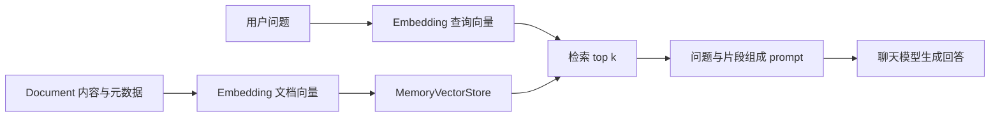

# RAG 复习笔记

## 文章主线

模型无法凭空知道私有或最新资料。先检索相关资料，再将片段加入提示词供模型回答：离线侧准备文档、生成向量、建立索引；查询侧将问题向量化、检索相近片段、组合上下文并生成。这里的离线和查询阶段只是逻辑划分，示例每次运行都会重新建内存索引。

二维水果示意帮助理解向量夹角；真实 embedding 的每个维度通常不能直接解释为某个具体属性。余弦相似度衡量方向相近程度，并不保证事实相关或正确；分块、召回数量、模型和内容质量都会影响效果。关键词检索适合精确名称或编号，也可以和向量检索结合。

## 代码对照

1. 原文 `src/hello-rag.mjs` → [src/00-hello-rag.mjs](src/00-hello-rag.mjs)：七个故事 `Document`，`MemoryVectorStore.fromDocuments` 建索引，`asRetriever({ k: 3 })`、`retriever.invoke` 检索，再拼接 prompt 生成。现有故事人物名为小明与东东，原文为光光与东东，流程相同。原文直接初始化模型，本仓库使用跨课程 `@lessons/shared/model` 和根 `.env`。
2. 已有 `src/loader-and-spiltter.mjs` → [src/01-loader-and-spiltter.mjs](src/01-loader-and-spiltter.mjs)：原文未包含的现有扩展，先抓取网页正文，再按 `chunkSize: 500`、`chunkOverlap: 50` 分块并检索 `k: 2`。切分与重叠可缓解跨块上下文丢失，但不能保证切分质量或每块均严格达到期望长度。

编号保留文件名主体，方便对应原文和历史代码；示例之间没有互相 import。模型和 embedding 初始化已复用 `lessons/_shared/model.mjs`，环境变量由 `lessons/_shared/env-loader.mjs` 读取，没有新增课内共享模块。检索与生成步骤留在示例内，便于对照文章。

## 分数与检索次数

当前安装版本源码的 `MemoryVectorStore` 默认采用余弦相似度，`similaritySearchWithScore` 返回 `[Document, score]`；因此直接展示 score，原文的 `1 - score` 会反转含义。不同存储实现可能返回距离或其他分值，应核对具体实现。两个示例先用 retriever 取文档，再调用带分数查询，便于对照 API，但会重复查询及 embedding；实际只需要一种结果时可选择相应接口。`retriever.invoke` 返回 `Document` 数组，不直接返回评分。现有按 `pageContent` 匹配评分的方式对重复内容不可靠，只适合作为本例展示。

故事样本已有章节与角色等元数据；元数据不必等同于完整原文，检索结果应保留可追溯来源。RAG 不保证消除幻觉；本例没有评测、权限过滤、持久化或引用校验。网页示例还受页面变动和网络限制。

## 复习与故障排查

可离线阅读两份源码并执行 `node --check`；执行完整脚本则需要可用聊天和 embedding API，网页扩展还需要访问目标网页。先检查根目录依赖安装和 README 中的环境变量，再检查服务商的模型、地址与权限。网页返回空内容时重点检查 selector；原始示例使用 `console.assert`，它不会阻止后续执行。参考 README 的最小阅读路径即可继续复习。
