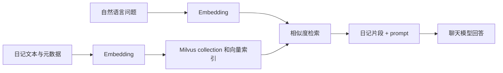

# Milvus 复习笔记

> 外部前置条件 / TODO：Milvus、Docker Compose 和模型服务需要自行准备。本课数据库操作未执行验证；电子书写入会删除重建整个集合，日记更新和删除会改动数据。

## 从问题到实现

文章从内存向量库不适合长期保存知识出发，引出 database → collection → entity，以及 schema 中的主键、文本、元数据、向量字段。`ai_diary` 使用 1024 维 `FloatVector`、IVF_FLAT 索引和 COSINE 度量；嵌入模型将日记和查询编码到同一向量空间，再通过相似度搜索候选数据。

语义检索与精确过滤可以配合；关键词检索、关系型查询仍有用，也不应把文章中“只能用关键词”的表述当成所有数据库的能力边界。RAG 有可能召回错误片段或生成无依据内容，结果并不天然可信。MySQL 与 Milvus 双写不是本例实现，真实系统还要处理一致性、失败重试与同步。

## 原路径与复习顺序

| 原路径 | 编号路径 | 对应内容 |
| --- | --- | --- |
| `src/insert.mjs` | [src/00-insert.mjs](src/00-insert.mjs) | 建集合、索引、加载并插入日记 |
| `src/query.mjs` | [src/01-query.mjs](src/01-query.mjs) | query 向量化并相似搜索 |
| `src/rag.mjs` | [src/02-rag.mjs](src/02-rag.mjs) | 基于日记片段生成回答 |
| `src/update.mjs` | [src/03-update.mjs](src/03-update.mjs) | 重新 embedding 后 upsert |
| `src/delete.mjs` | [src/04-delete.mjs](src/04-delete.mjs) | ID、批量及条件删除 |
| `src/ebook-writer.mjs` | [src/05-ebook-writer.mjs](src/05-ebook-writer.mjs) | 现有扩展：EPUB 导入 |
| `src/ebook-query.mjs` | [src/06-ebook-query.mjs](src/06-ebook-query.mjs) | 现有扩展：按书籍过滤检索 |
| `src/ebook-reader-rag.mjs` | [src/07-ebook-reader-rag.mjs](src/07-ebook-reader-rag.mjs) | 现有扩展：电子书问答 |

编号是文件重命名，保留原文件名主体和原有注释；电子书内容不是本篇日记示例。`package.json`、文档、EPUB 配套资源和 `src/` 目录不参与脚本编号。

## 关键细节与限制

- `fromDocuments` 属于第 6 课的 LangChain 向量库接口；这里使用 Milvus SDK 显式执行 `createCollection`、`createIndex`、`loadCollection`、`insert` 和 `search`。
- 插入/查询/更新分别对内容或问题做 embedding，删除按条件执行，不需 embedding。内容改变而向量不变会使检索失真；更换模型后即使维度相同也可能不兼容，通常应重建相应索引数据。
- `00` 无已有集合处理，重复执行可能失败；`03` 修改 `diary_001`；`04` 按 ID 和 `mood == "sad"` 删除，最后一项会影响所有符合条件的记录。每个脚本操作共享集合，需隔离测试数据。
- `05` 在读取 EPUB 之前调用 `recreateCollection` 并删除 `ebook_collection`，其中全部书籍数据都会丢失，且失败后没有回滚。`loader.load()` 先加载所有章节；后续按章节切分和写入，所以不是端到端流式读取。并发 embedding 可能受限流或费用影响。
- 两个 RAG 示例将检索错误捕获为空数组，因而可能把服务故障显示成“未找到相关内容”；不要将该提示视作成功检索的证明。`score` 的含义应结合当前度量及 SDK 版本判断。
- 当前代码使用共享 `createChatModel` / `createEmbeddings` 与根目录环境加载，保持各示例中的维度参数可读。课内七份 `getEmbedding` 只是 `embedQuery` 的一层演示性包装；Milvus 客户端构造在多课出现，但这里保留原文直接连接写法，便于对照 SDK 和各课的地址配置，没有为简单构造包装引入共享工厂。无课内空 `_shared/` 目录。

## 无服务时如何复习

先读 00 的字段、索引和写入数据结构，再读 01 的 search 和 02 的 prompt；对照 03/04 理解更新与删除对状态的影响，最后阅读 05～07 的 EPUB 分块和 `book_id` 过滤。可静态语法检查，不需要启动服务。完整运行需要 README 中列出的外部条件；本次没有执行数据库、Docker、模型或网页服务。
